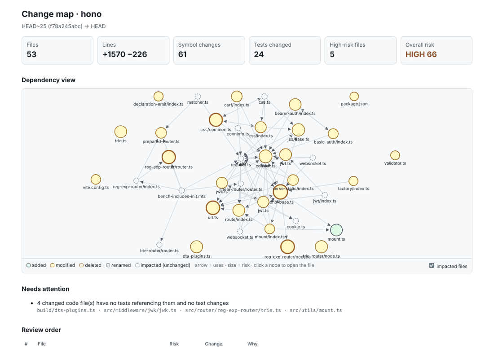

<p align="center">
  
</p>

<p align="center">
  <b>The self-growing, token-frugal toolkit for AI coding agents.</b><br>
  One install. Every agent. Smarter every session.
</p>

<p align="center">
  <a href="https://github.com/Cinct00/kickoff/actions/workflows/validate.yml"></a>
  <a href="LICENSE"></a>
  
  
  <a href="docs/platforms.md"></a>
  <a href="https://github.com/Cinct00/kickoff/stargazers"></a>
</p>

<p align="center">
  <a href="#quick-start">Quick start</a> ·
  <a href="#why-kickoff">Why Kickoff</a> ·
  <a href="#whats-inside">What's inside</a> ·
  <a href="docs/architecture.md">Architecture</a> ·
  <a href="docs/contributing.md">Contributing</a>
</p>

---

**Kickoff** is the self-growing, token-frugal brain upgrade for AI coding agents. One install drops the same **routing engine, 30+ expert skills, specialist sub-agents, guard-rail hooks and a lightning-fast code map** into **Claude Code, the Claude app, GitHub Copilot (CLI, cloud agent, VS Code) and any Agent Skills client**. It wires in a hand-picked profile of Anthropic, GitHub and partner plugins, and when it hits a gap it searches a catalog of **~700 more**.

And it **learns**. Every task ends with a *harvest*: the procedures, fixes and lessons from that session flow straight back into the toolkit as new skills, agents, hooks and routes. Your setup gets smarter every time you use it.

| 96% | 91–97% | 0 |
|:---:|:---:|:---:|
| fewer tokens to find and understand code | fewer tokens to orient in a new repo | tokens spent by guard-rails until they matter |

```
task ──▶ kickoff ──▶ route: judgment skill + procedure tool ──▶ do the work ──▶ harvest
            │             │                                                    │
            │             └─ code questions ─▶ codemap index (≈5% of grep-and-read tokens)
            └── gap? search catalog (700 plugins) ─▶ install / recommend        └─▶ new skill / agent / hook / route
                     nothing fits ─▶ log gap ───────────────────────────────────────▶ written back into this repo
doctor / audit / catalog refresh keep installs current, duplicates out and the always-on token cost visible
```

---

## Why Kickoff

| | |
|---|---|
| **It routes, so your agent doesn't flail** | `kickoff` classifies every substantial task and loads exactly the right skills, agents and plugin commands for the platform you're on. No more prompt roulette. |
| **It sees code at ~5% of the cost** | `codemap` indexes symbols, imports, references and packages, and answers with surgical, line-numbered precision instead of grep-and-read floods. |
| **It reviews PRs like a principal engineer** | `codemap review` turns any diff into a risk-ranked structural change map: broken callers, missing tests, dependency changes and an interactive HTML report. |
| **It looks local first** | The `local-first` hook catches remote MCP, web and `curl`/`gh` lookups for code or docs you already have on disk, and points the agent at the local copy. Faster answers, the right version, zero tokens when it stays quiet. |
| **It grows itself** | Harvest writes reusable work back into the toolkit. Promote, commit, push, and every device and every adopted repo levels up. |
| **It's built to be trusted** | Repositories are treated as untrusted input: no symlink escapes, no runaway files, a read-only MCP tool, hooks that fail open, and upstream plugins referenced, never copied. |
| **It goes everywhere** | Claude Code, Copilot CLI, Copilot cloud agent, VS Code, Codex, Cursor and Gemini CLI. One source of truth, generated for each client. |

---

## Quick start

### On a new device

```bash
git clone https://github.com/Cinct00/kickoff ~/.kickoff
```

```bash
python3 ~/.kickoff/scripts/toolkit.py install --dry-run
```

```bash
python3 ~/.kickoff/scripts/toolkit.py install
```

`install` detects every AI client you have and wires Kickoff into each one: it registers this marketplace and the upstream ones, then installs the toolkit plugins plus your plugin profile.

| Client | What happens |
|---|---|
| Claude Code (`claude`) | `claude plugin marketplace add …` + `claude plugin install <plugin>@<marketplace>` for the toolkit and every profile plugin |
| GitHub Copilot CLI (`copilot`) | the same with `copilot plugin …` (Copilot reads the same marketplace format) |
| GitHub Copilot, user level (`~/.copilot` exists) | skills → `~/.copilot/skills`, agents → `~/.copilot/agents`, hooks → `~/.copilot/hooks/kickoff.json`, codemap MCP → `~/.copilot/mcp-config.json`: one install serves every repo on the device (CLI, cloud-agent-style sessions and VS Code) |
| Everything else (Codex, Cursor, Gemini CLI…) | toolkit skills symlinked into `~/.agents/skills` (`--skills-dir` to add more) |
| Shell | a `codemap` command in `~/.local/bin` |

Options: `--bundle core|dev|full`, `--target claude|copilot|copilot-user|claude-user|skills`, `--no-upstream`, `--local` (use this checkout instead of GitHub), `--global-instructions` (adds a kickoff pointer to `~/.claude/CLAUDE.md`, `~/.copilot/copilot-instructions.md`, `~/.codex/AGENTS.md`). Or use `./install.sh` / `./install.ps1`, which clone and run it for you.

Stay current with `python3 ~/.kickoff/scripts/toolkit.py sync` and healthy with `doctor` (see [Keeping it alive](#keeping-it-alive)).

### Just the marketplace

```
/plugin marketplace add Cinct00/kickoff          # Claude Code
/plugin install kickoff@kickoff
```

```bash
copilot plugin marketplace add Cinct00/kickoff
```

```bash
copilot plugin install kickoff@kickoff
```

### Supercharge a whole team's repo (including the Copilot cloud agent)

```bash
python3 ~/.kickoff/scripts/toolkit.py adopt path/to/project --bundle dev --upstream feature-dev@claude-plugins-official
```

This writes `extraKnownMarketplaces` + `enabledPlugins` into the project's `.claude/settings.json` **and** `.github/copilot/settings.json` (read by Copilot CLI *and* the Copilot cloud agent), adds a kickoff block to `AGENTS.md`, makes `CLAUDE.md` import it, and starts a gaps ledger. `--mode vendor` copies the skills and agents into `.claude/` instead, for clients without plugin support, and never overwrites files your team has customised (`--force` to override). Or, from inside the project, just ask your agent to run the `toolkit-adopt` skill: it inventories the repo and picks the set for you.

---

## What's inside

### Toolkit plugins

<!-- BEGIN GENERATED:plugins -->
| Plugin | Skills | Agents | Hooks | What it is for |
|---|---|---|---|---|
| [`kickoff`](plugins/kickoff) | 3 | 1 | yes | The router. Classifies a task, loads the right skills, agents and plugin commands on whatever platform you are on, checks the catalog for gaps and existing plugins that fill them, then harvests reusable work back into the toolkit so it grows. |
| [`codemap`](plugins/codemap) | 2 | 1 | yes | Token-efficient repository map and change review: a SQLite index of symbols, imports, references and packages with a ranked repo map, search, outlines, exact symbol source, refs/callers and impact queries, plus structural PR change maps (risk order, broken callers, test gaps, Mermaid/HTML views, AI-review packs). CLI + single-tool MCP server. |
| [`local-first`](plugins/local-first) | 0 | 0 | yes | Local-first lookups: a PreToolUse hook that stops MCP, WebFetch and curl/gh calls from fetching remote code or docs that already exist on disk (local clones, installed dependencies, mapped docs folders) and points the agent at the local paths instead. Zero tokens unless it redirects. |
| [`engineering-craft`](plugins/engineering-craft) | 11 | 0 | — | Judgment skills for software work: understanding the problem, scoping, implementing, exploring code, architecture, debugging, testing, reviewing, refactoring, incidents and technical communication. |
| [`thinking-tools`](plugins/thinking-tools) | 10 | 0 | — | Reasoning skills: first principles, systems thinking, probabilistic thinking, decisions, creativity, maths, scientific method, evaluating information and research. |
| [`communication-and-leadership`](plugins/communication-and-leadership) | 7 | 0 | — | Skills for writing, teaching, presenting, persuading, hard conversations, meetings and leading a team. |
| [`doc-coauthor`](plugins/doc-coauthor) | 1 | 3 | — | Three-stage document co-authoring (context, draft, reader-simulation review) with isolated sub-agents. For RFCs, PRDs, decision docs, architecture specs and proposals. |
<!-- END GENERATED:plugins -->

Bundles (`toolkit.json` → `bundles`): **core** = kickoff, codemap, local-first · **dev** = core + engineering-craft, thinking-tools, doc-coauthor · **full** = everything.

### Your plugin profile (Anthropic, GitHub and partners)

Installed by `toolkit.py install` from their upstream marketplaces, so they stay current and their licenses stay with them. Edit `toolkit.json` → `upstream.profile` to make it yours.

<!-- BEGIN GENERATED:profile -->
| Group | Plugins |
|---|---|
| engineering | `feature-dev@claude-plugins-official`, `pr-review-toolkit@claude-plugins-official`, `code-review@claude-plugins-official`, `code-simplifier@claude-plugins-official`, `code-modernization@claude-plugins-official`, `security-guidance@claude-plugins-official`, `claude-security@claude-plugins-official`, `ralph-loop@claude-plugins-official`, `engineering@knowledge-work-plugins` |
| toolkit-growth | `skill-creator@claude-plugins-official`, `hookify@claude-plugins-official`, `claude-code-setup@claude-plugins-official`, `claude-md-management@claude-plugins-official` |
| frontend-and-design | `frontend-design@claude-plugins-official`, `modern-web-guidance@claude-plugins-official`, `playground@claude-plugins-official`, `design@knowledge-work-plugins` |
| data-and-documents | `data@knowledge-work-plugins`, `pdf-viewer@knowledge-work-plugins`, `document-skills@anthropic-agent-skills`, `example-skills@anthropic-agent-skills` |
| work-and-domain | `productivity@knowledge-work-plugins`, `cowork-plugin-management@knowledge-work-plugins`, `market-researcher@claude-for-financial-services`, `ai-governance-legal@claude-for-legal`, `learn-with-coursera@claude-plugins-official` |
<!-- END GENERATED:profile -->

### codemap: navigate code at ~5% of the tokens

`codemap` indexes a repository's symbols, imports, references and packages into SQLite (in your user cache, never the repo) and answers in compact, line-numbered text:

```bash
codemap overview                      # ~250 tokens: languages, dirs, entry points, central files, packages
codemap map --focus src/auth.py       # ranked signatures around what you're working on, within a token budget
codemap find user session             # symbol search (camelCase/snake_case aware)
codemap outline src/auth.py           # every symbol with line ranges, instead of reading the file
codemap show AuthService.login        # exactly one symbol's source
codemap refs AuthService              # uses grouped by file and enclosing function
codemap impact src/models/user.py     # dependents by distance + tests to run
```

Measured on real open-source repos (Python, TypeScript, Go, Java, C#, Rust): **96% fewer tokens** to locate and understand a symbol than grep-and-read, **91–97% fewer** to orient in a new repo. It's also a single-tool, read-only MCP server, so Claude Code and Copilot call it directly. C# and Rust get dedicated structural parsers that match tree-sitter (**99.9% and 100% recall** on 37k declarations), Python uses its own `ast`, and TS/JS, Go, Java, Kotlin, Scala, C/C++, PHP, Ruby, Swift and Markdown use patterns. Pure stdlib: nothing to `pip install`. Design, benchmarks and the alternatives we rejected (Docker in-memory DBs, graph DBs, LSP, embeddings) are in [docs/codemap.md](docs/codemap.md).

### Change review: see what a PR *really* changed

`codemap review` turns a PR, branch or local diff into a **structural change map**:
- Symbol-level changes (`~` signature, `-` removed, `→` renamed or moved, `*` modified, `+` added).
- **Callers outside the diff** that a signature change, removal or deleted module will break.
- A **risk-ranked review order**, so humans and AI reviewers start where it matters.
- Affected and missing tests, and dependency changes.

It renders as a PR comment with a Mermaid dependency view, an interactive HTML report, or a budgeted pack for AI reviewers (**84–99% fewer tokens** than patch + files on real multi-file changes). `toolkit.py adopt <repo> --review-workflow` puts it on every pull request. See [docs/change-review.md](docs/change-review.md).



### local-first: stop paying for what you already have

Agents love to fetch a file from GitHub, query Context7 or hit a docs site when the exact same content is sitting in a local clone, `node_modules`, a virtualenv or your docs folder. The `local-first` PreToolUse hook spots that, blocks the first remote call and hands the agent the local paths. Need the remote version anyway? Repeat the call and it goes through. Calls with no local copy pass silently, so it costs **zero tokens** until it saves you some. Details in [plugins/local-first](plugins/local-first/README.md).

### discover and vet: know what you have, trust what you add

Most of what an agent needs is often already on the machine: Copilot skills, agents and prompts in `~/.copilot` and `.github/`, Claude agents, VS Code MCP servers, team instructions. `toolkit.py discover` inventories all of it (Copilot, Claude Code, Agent Skills, Codex, Gemini, VS Code, plus the current repo) into `~/.config/kickoff/local-inventory.tsv`, refreshed in the background once a day, and kickoff checks it **before** the catalog.

Everything discovered, and anything you are about to install, goes through `toolkit.py vet`: a static scan for pipe-to-shell installers, permission-bypass flags, prompt-injection text, hidden Unicode, model base-URL hijacks, unpinned or plain-HTTP MCP servers, credential reads and symlink escapes. Vet a plugin straight from GitHub with `toolkit.py vet --git owner/repo --subdir plugins/name`. Kickoff vets every non-official plugin before recommending it, and `doctor` flags anything installed that scans as high-risk. A clean scan is not a proof of safety, but a flagged one is a reason to read before you run.

### The catalog

[`catalog/CATALOG.md`](catalog/CATALOG.md) lists every plugin in the tracked marketplaces (Anthropic official, knowledge-work, agent skills, financial services, legal, GitHub `copilot-plugins` and `awesome-copilot`), with their skills, agents, commands, hooks and MCP servers. Kickoff ships a grep-friendly copy ([`catalog.tsv`](plugins/kickoff/skills/kickoff/references/catalog.tsv)) so it finds an existing plugin before building anything new. Refresh with `python3 scripts/toolkit.py catalog`.

### All skills

<details>
<summary>Every skill in Kickoff</summary>

<!-- BEGIN GENERATED:skills -->
| Skill | Plugin | Use it when |
|---|---|---|
| `harvest` | kickoff | Turns reusable work from the current session into new or improved skills, agents, hooks and kickoff routes, written in a portable format th… |
| `kickoff` | kickoff | Routes a task to the right skills, agents and plugin commands on whatever platform you are running on (Claude Code, Claude app, GitHub Copi… |
| `toolkit-adopt` | kickoff | Brings Kickoff into another repository so kickoff, the judgment skills and the right Anthropic, GitHub and partner plugins work there for e… |
| `change-review` | codemap | Review a pull request, branch or local diff from its structural change map instead of a raw diff: symbol-level changes, a risk-ranked revie… |
| `codemap` | codemap | Navigate a codebase through its indexed map instead of grepping and reading whole files: overview, ranked repo map, symbol search, definiti… |
| `architecting-solutions` | engineering-craft | How to design a solution before building it — generating options, weighing trade-offs, choosing where to spend design effort, and writing d… |
| `debugging-systematically` | engineering-craft | A hypothesis-driven method for diagnosing and fixing bugs — reproduction, bisection, instrumentation, and verifying the real cause instead… |
| `exploring-unfamiliar-code` | engineering-craft | How to orient quickly in an unfamiliar codebase or an unfamiliar corner of a familiar one — building a working mental model without reading… |
| `implementing-changes` | engineering-craft | How to actually write a change once the problem and approach are clear — slicing work, matching the codebase, handling errors, naming, self… |
| `incident-response` | engineering-craft | How to handle production incidents — mitigate before diagnosing, preserve evidence, communicate on a cadence, escalate early, and turn the… |
| `refactoring-and-legacy-code` | engineering-craft | How to change code safely when it is old, untested, load-bearing, or scary — characterization tests, seams, small reversible steps, and inc… |
| `reviewing-code` | engineering-craft | How to review code effectively — understanding intent first, hunting correctness bugs over style, verifying claims instead of trusting the… |
| `scoping-and-estimation` | engineering-craft | How to size work honestly, slice it into shippable increments, handle uncertainty with spikes, and renegotiate scope when reality disagrees… |
| `technical-communication` | engineering-craft | How to write the artifacts engineering runs on — commit messages, PR descriptions, design notes, status updates, bug reports, and deliverin… |
| `testing-strategy` | engineering-craft | How to decide what to test, at what level, and how to write tests that catch real regressions without calcifying the code — edge case enume… |
| `understanding-the-problem` | engineering-craft | How to take an ambiguous task, ticket, or request and turn it into a clear problem statement with acceptance criteria before writing any co… |
| `creative-thinking` | thinking-tools | How to generate genuinely new ideas on demand — separating generation from judgment, using constraints as fuel, combining distant material,… |
| `evaluating-information` | thinking-tools | How to judge whether a claim is true — tracing sources, reading incentives, spotting the standard statistical sleights, and holding confide… |
| `first-principles-thinking` | thinking-tools | How to reason from fundamentals instead of by analogy or convention — decomposing problems into what is actually true and rebuilding from t… |
| `from-knowledge-to-judgment` | thinking-tools | How knowledge actually becomes judgment — why the deepest expertise can't be written down, how it's really acquired (reps, stakes, feedback… |
| `making-decisions` | thinking-tools | A practical framework for consequential decisions — sizing, base rates, pre-mortems, reversibility, a mental-model catalog and checklist |
| `mathematical-thinking` | thinking-tools | How mathematicians actually think — precise definitions, playing with small cases, estimation and Fermi reasoning, exponentials and logarit… |
| `probabilistic-thinking` | thinking-tools | How to reason under uncertainty — thinking in distributions instead of points, starting from base rates, updating on evidence proportionall… |
| `researching-a-topic` | thinking-tools | How to research any unfamiliar topic efficiently — mapping the territory before the details, acquiring the field's vocabulary, finding the… |
| `systems-thinking` | thinking-tools | How to see and influence systems — feedback loops, delays, incentives, bottlenecks, and second-order effects — instead of treating every pr… |
| `thinking-like-a-scientist` | thinking-tools | How to think scientifically — forming falsifiable hypotheses, designing experiments with controls, respecting measurement error, treating m… |
| `difficult-conversations` | communication-and-leadership | How to have the conversations people avoid — giving and receiving hard feedback, raising conflicts early, disagreeing without damage, and r… |
| `leading-a-team` | communication-and-leadership | How to lead when the output is no longer yours — delegating outcomes, giving context instead of control, running 1:1s that surface truth, b… |
| `persuasion-and-negotiation` | communication-and-leadership | How to change minds and reach agreements ethically — interests over positions, BATNA, expanding the pie, plus a salary and offer negotiatio… |
| `presenting-and-public-speaking` | communication-and-leadership | How to present so the audience leaves changed — one-message design, story structure over bullet lists, slides that serve the speaker, rehea… |
| `running-meetings` | communication-and-leadership | How to make meetings earn their cost — deciding whether to meet at all, agendas as questions, facilitation that surfaces the quiet voices,… |
| `teaching-and-explaining` | communication-and-leadership | How to teach and explain so understanding actually transfers — defeating the curse of knowledge, anchoring to what learners already know, e… |
| `writing-clearly` | communication-and-leadership | How to write prose that works — essays, emails, proposals, articles, anything meant to be read — through reader-first structure, drafting f… |
| `doc-coauthor` | doc-coauthor | Co-author a substantial document (RFC, PRD, decision doc, architecture or technical spec, proposal) through three isolated stages: context… |
<!-- END GENERATED:skills -->

</details>

---

## How it grows

1. **Kickoff** routes every substantial task and checks the catalog. Missing tool → install line or recommendation. Nothing fits → a logged gap.
2. **Harvest** runs at the end (a `Stop` hook in Claude Code reminds once if it was skipped). It turns recurring procedures, corrections and gaps into skills, agents, hooks or new kickoff routes, written in the portable format **into this repo** when it is on disk, or into the project's `.claude/` otherwise.
3. **Promote** project-local discoveries with `toolkit.py promote <dir> --plugin <plugin>`.
4. **Validate, commit, push**, and every device picks it up with `toolkit.py sync`; every adopted project picks it up on its next plugin update. Compounding returns, on autopilot.

## Keeping it alive

| | |
|---|---|
| `toolkit.py doctor [--repo PATH] [--fix]` | Broken or stale user-level installs, new toolkit items not yet installed, uncommitted harvests, and **repo-vendored copies that shadow your user-level skills** (Copilot lets project skills override personal ones). `--fix` repairs only what the toolkit provably wrote. Runs automatically (quietly) once a day at session start. |
| `toolkit.py audit` | Always-on token cost per bundle, oversized descriptions, overlapping skills, routes and profile plugins that vanished upstream, skills untouched for six months. |
| `toolkit.py discover` / `vet` | Inventory of everything agent-related on the device and repo; security scan of any plugin, skill, hook or MCP config (`--git owner/repo` to vet before installing). |
| `toolkit.py catalog` | Rescans upstream marketplaces; a weekly workflow opens a PR when something new appears. |
| `python3 -m unittest discover -s tests` | 124 tests: codemap extraction/resolution/queries/MCP across languages, untrusted-repo safety, change review (incl. HTML escaping), install, adopt, doctor, every hook, the PR action. |

See [docs/maintenance.md](docs/maintenance.md) for the loops and the Copilot user-level migration, [docs/architecture.md](docs/architecture.md) for the design, [docs/platforms.md](docs/platforms.md) for the per-client compatibility matrix, and [docs/contributing.md](docs/contributing.md) for adding components.

---

## Contributing

New skills, agents, hooks and routes are welcome: most arrive through `harvest`, and [docs/contributing.md](docs/contributing.md) covers adding them by hand. Before opening a PR, run `python3 scripts/toolkit.py build && python3 scripts/toolkit.py validate` and `python3 -m unittest discover -s tests`; every PR gets a codemap change map.

## License

Kickoff is [MIT](LICENSE). Upstream plugins are **referenced, not copied**: each is installed from its own marketplace under its own license (most Anthropic plugins are Apache-2.0; some, such as `claude-security` and the `document-skills`, are proprietary and only installable, not redistributable). `toolkit.py validate` refuses vendored files carrying proprietary license markers.
