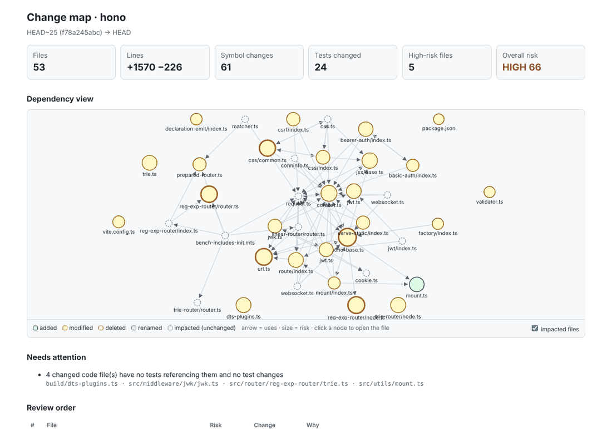
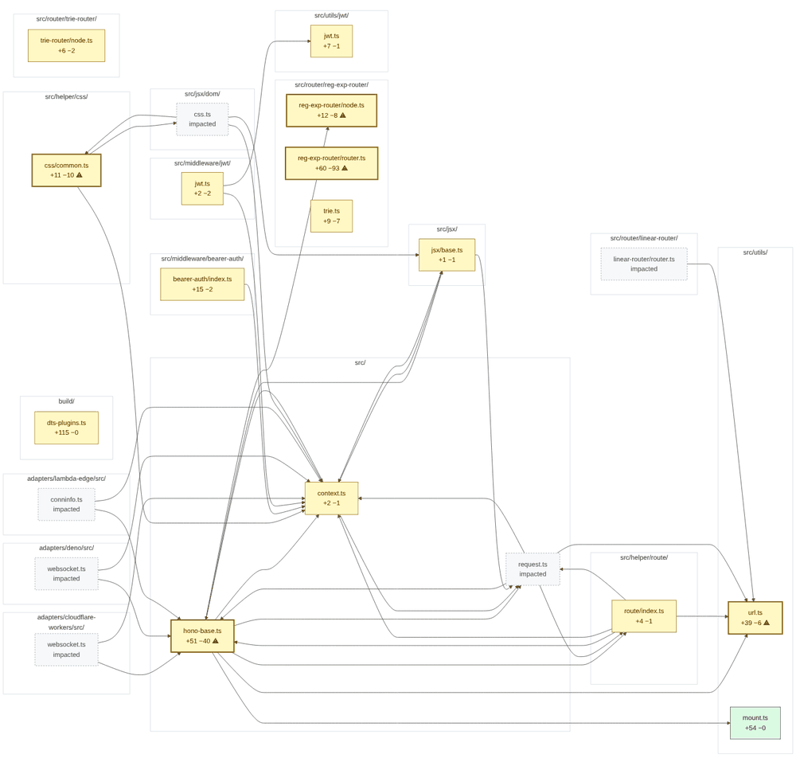
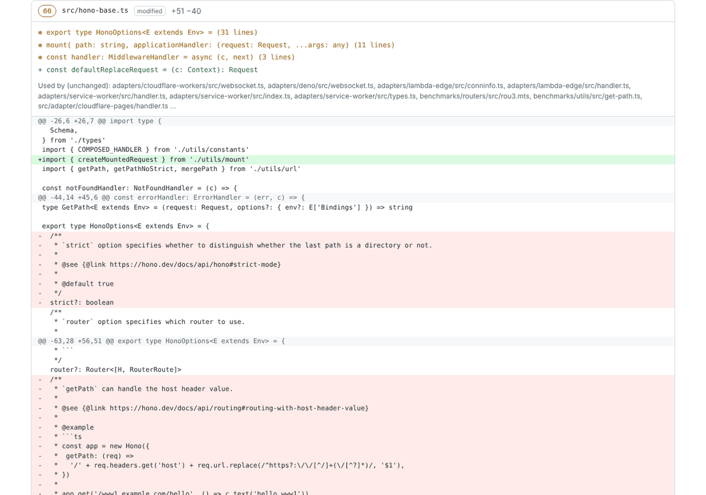

# Change review

`codemap review` turns a pull request, branch or local diff into a **structural change map**: what changed at the symbol level, what it can break outside the diff, which tests matter, and where a reviewer should look first. The same analysis renders as a PR comment, an interactive HTML report, a token-budgeted pack for AI reviewers, or JSON.



## What it finds

| Signal | How |
|---|---|
| **Symbol-level changes** | Both sides of every changed file go through the codemap extractor and get matched by qualified name: `~` signature changed (old → new shown), `-` removed, `→` renamed (same body, new name) or moved (same body, another file), `*` modified (lines changed inside its own body, not its children's), `+` added |
| **Callers outside the diff** | For signature changes, removals, renames and moves: files that use the name *and* import the changed file (or share its package in Go/JVM/C#/Swift), and are not in the diff. These are the classic "forgot to update a caller" bugs |
| **Risk score per file** | Dependency centrality (PageRank percentile), churn, number of dependents outside the change, public API changes, callers outside the diff, sensitive paths (auth, tokens, payments, migrations, CI, infra), and test coverage. Generated and lock files are marked "skim" |
| **Tests** | Changed tests; tests that reference changed code but weren't changed ("run them"); changed code that no test references and no changed test covers |
| **Dependencies** | Packages added, removed or re-versioned in any manifest codemap reads |
| **Dependency view** | Changed files plus the unchanged files most affected by them, with the edges between them from the repository's import/reference graph |

## Outputs

| Format | For | Command |
|---|---|---|
| text (default) | you, in the terminal; quick AI orientation (~1k tokens) | `codemap review` |
| context | AI reviewers: risk-ordered structure + hunks fitted to a token budget | `codemap review --format context --budget 8000` |
| md | PR comment / job summary, with a Mermaid diagram GitHub renders | `codemap review --format md` |
| html | an interactive, self-contained page (no network, light/dark, mobile) | `codemap review --format html --out change-map.html` |
| json | other tools | `codemap review --format json` |

Defaults: base is the merge-base with origin's default branch (`--base` to override), head is the working tree including uncommitted and untracked files (`--head REF` for a commit).

The PR comment's dependency view (Mermaid, rendered by GitHub), with status colours, high-risk files in bold, and impacted-but-unchanged files dashed:



Each file in the HTML report shows its symbol changes, the unchanged files that use it and the diff:



## On every pull request

```bash
python3 ~/.ai-toolkit/scripts/toolkit.py adopt path/to/repo --review-workflow
```

This adds `.github/workflows/change-map.yml`, which runs the [`change-map` action](../.github/actions/change-map/action.yml) and produces three things:

- **A sticky PR comment**, created once and updated on each push. It holds the summary, the Mermaid view, attention items, the review order, symbol changes, tests and dependencies.
- **The same content in the job summary**, which also works for fork PRs, where the token can't comment.
- **An artifact** with `change-map.html`, `review-pack.txt` and `change-map.json`. The action also exposes `review-pack` as an output, so a following AI-review step can put it in its prompt.

Security: the action runs codemap from its own pinned ref, never from the pull request checkout. It only reads and parses the PR's files, never executes them. It uses `pull_request`, not `pull_request_target`, and passes every input through environment variables. Pin `@<sha>` instead of `@main` in production.

## Measured

Review pack (budget 8,000) vs what a reviewer otherwise reads (the full patch plus every changed text file), on real commit ranges (`python3 tests/bench_codemap.py --review repo:BASE..HEAD`):

| Repo | Range | Files | Patch + files | Review pack | Saved | Analysis |
|---|---|---:|---:|---:|---:|---:|
| hono (TS) | `HEAD~25..HEAD` | 53 | 223,407 | 8,013 | 96% | 1.2 s |
| hono | `HEAD~5..HEAD` | 14 | 92,571 | 7,623 | 92% | 0.4 s |
| cobra (Go) | `HEAD~20..HEAD` | 20 | 98,506 | 7,649 | 92% | 0.4 s |
| cobra | `HEAD~3..HEAD` | 8 | 54,935 | 2,277 | 96% | 0.2 s |
| requests (Python) | `HEAD~20..HEAD` | 10 | 5,757 | 2,105 | 63% | < 0.1 s |
| requests | `HEAD~4..HEAD` | 4 | 1,728 | 703 | 59% | < 0.1 s |
| Newtonsoft.Json (C#) | `HEAD~30..HEAD` | 138 | 1,014,874 | 8,039 | 99% | 4.0 s |
| Newtonsoft.Json | `HEAD~5..HEAD` | 10 | 115,902 | 7,555 | 93% | 0.3 s |
| Polly (C#) | `HEAD~30..HEAD` | 35 | 74,037 | 8,030 | 89% | 0.3 s |
| Polly | `HEAD~5..HEAD` | 4 | 3,358 | 731 | 78% | < 0.1 s |
| eShop (C#) | `HEAD~30..HEAD` | 251 | 490,529 | 8,022 | 98% | 1.6 s |
| eShop | `HEAD~5..HEAD` | 24 | 51,734 | 8,027 | 84% | 0.2 s |
| ripgrep (Rust) | `HEAD~30..HEAD` | 42 | 245,130 | 8,022 | 97% | 1.1 s |
| ripgrep | `HEAD~5..HEAD` | 7 | 63,767 | 5,277 | 92% | 0.3 s |
| axum (Rust) | `HEAD~30..HEAD` | 54 | 285,368 | 8,030 | 97% | 1.0 s |
| axum | `HEAD~5..HEAD` | 14 | 100,695 | 8,030 | 92% | 0.2 s |
| serde (Rust) | `HEAD~30..HEAD` | 34 | 132,033 | 8,016 | 94% | 0.8 s |
| serde | `HEAD~5..HEAD` | 11 | 37,348 | 1,817 | 95% | 0.2 s |
| **total** | | | **3,091,679** | **107,966** | **96.5%** (median 92.5%) | |

On large changes the pack spends its budget on the riskiest files first and names the rest; above about 100k tokens of change it is a triage view, not a full review. On small PRs it carries nearly the whole diff plus the structure, so the saving is smaller but each token carries more context.

## Limits

- Analysis is name-based with import awareness, not type checking. Dynamic dispatch, reflection and string-wired code are invisible, and common or overloaded names can add extra "callers". Treat attention items as leads to verify.
- Impact uses the index of the checked-out tree. When reviewing `--head <ref>` locally, check that ref out first for accurate impact.
- Diffs larger than 400 lines per file are truncated in the report; `codemap show` and `git diff` remain available.
